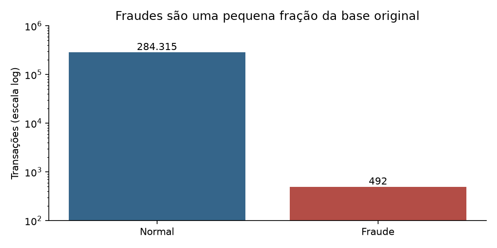
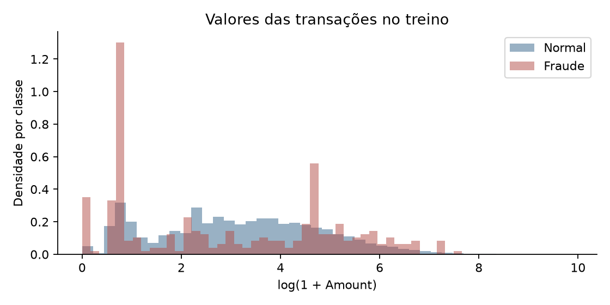
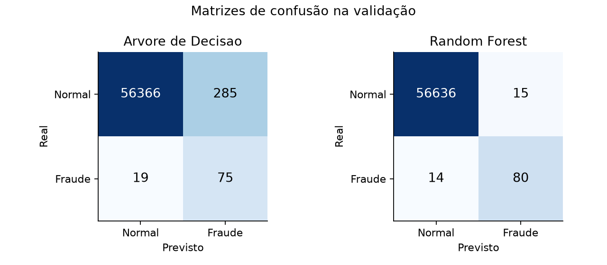

# Random Forest - Caçador de Fraudes

Projeto de Inteligência Artificial II da FIB, grupo 3. Checkpoint 1 de 27/10/2026.

O primeiro pipeline executa auditoria, preparação, treino, avaliação na validação
e previsão. Objetivo: apoiar a triagem de transações suspeitas e comparar
Random Forest com uma Árvore de Decisão, equilibrando fraudes identificadas e alertas falsos.

## Roteiro para explicar ao professor

Leia o [guia resumido](docs/05_Guia_Explicacao_Professor.pdf), com fala de 4 a 5 minutos,
perguntas e respostas e cinco artigos científicos identificados.
O roteiro acompanha o README: objetivo, dataset, execução, resultados e limitações.

## Integrantes e entregas definidas pelo grupo

| Integrante | Entrega | Apresentação |
|---|---|---|
| Lavinia Zanata Alves | Resumo expandido e Instagram | Problema, contexto e objetivo |
| Maicon Manoel Rodrigues dos Santos | Vídeo e Model Card | Público, dataset e qualidade |
| Gabriel Damante Frias | Folder | Random Forest e baseline |
| André Luiz Jeremias Pereira Junior | Ficha de experimentos | Hipóteses, experimentos e métricas |
| Felipe Inácio de Paula | GitHub e protótipo | Erros, demonstração e conclusão |

A atribuição técnica de limpeza, EDA, treino e avaliação precisa ser confirmada
pelo grupo. A produção inicial deste pacote teve apoio de IA, documentado em
docs/diario_ia.md. Não foram simulados commits ou participação dos integrantes.

## Dataset e fonte

[Credit Card Fraud Detection - ULB/Worldline](https://www.kaggle.com/datasets/mlg-ulb/creditcardfraud).
284.807 transações, 492 fraudes, 30 entradas e alvo Class.
Sem ausentes; 1.081 duplicados completos adicionais removidos antes da separação.
Após a limpeza: 283.726 linhas, 473 fraudes.
Descrição, atribuição, licença e SHA-256 em [data/README.md](data/README.md).
O CSV completo não deve entrar no Git.

## Instalação

Ambiente executado: Python 3.12.14; dependências fixadas em requirements.txt.
Use Python 3.12 ou superior compatível com as versões fixadas.
No terminal, na raiz do projeto:

```powershell
python -m venv .venv
.venv/Scripts/python.exe -m pip install -r requirements.txt
.venv/Scripts/python.exe src/baixar_dados.py
.venv/Scripts/python.exe src/pipeline.py
.venv/Scripts/python.exe src/prever.py
```

Alternativa no Windows: `powershell -ExecutionPolicy Bypass -File EXECUTAR.ps1`.
O Bypass vale apenas para esse processo. A instalação ocorre no ambiente local .venv.
Linux/macOS: criar o mesmo ambiente e usar `.venv/bin/python` nos comandos.
O download é público; se falhar, obtenha creditcard.csv na página oficial e salve em data/.

## Demonstração sem retreinar

Após instalar as dependências, `python src/prever.py` usa o modelo já fornecido
e dez transações em demo/transacoes.csv. Gabarito separado em demo/gabarito.csv.

```powershell
python src/prever.py --csv demo/transacoes.csv --saida results/previsoes_demo.csv
```

Para uma entrada nova, forneça as 30 colunas Time, V1 até V28 e Amount.
Não inclua Class. CSV com colunas faltantes, extras ou valores não finitos é rejeitado.
O score não é calibrado e não representa certeza. Não carregue modelos joblib de terceiros desconhecidos.

## Resultados preliminares na validação

56.745 transações, com 94 fraudes. Positivo = fraude.

| Modelo | Precisão | Recall | F1 | AP | FP | FN |
|---|---:|---:|---:|---:|---:|---:|
| Sempre normal | 0,00% | 0,00% | 0,0000 | 0,0017 | 0 | 94 |
| Árvore de Decisão | 20,83% | 79,79% | 0.3304 | 0.4948 | 285 | 19 |
| Random Forest | 84,21% | 85,11% | 0.8466 | 0.8611 | 15 | 14 |

AP = Average Precision, calculada com average_precision_score, sem confundi-la
com área trapezoidal idêntica. Não usar apenas acurácia nem a média ponderada de F1.
Sem otimização por esses resultados; a comparação é inicial e o teste está reservado.





## Metodologia e reprodução

- Semente 42; separação estratificada 60% treino, 20% validação, 20% teste.
- EDA detalhada só no treino. Teste não avaliado nesta entrega.
- Deduplicação integral, sem exclusão por outliers ou reamostragem.
- Sem normalização; sem nova PCA. Class excluída das entradas.
- Árvore: max_depth=12, min_samples_leaf=2, class_weight=balanced.
- Floresta: mesmos três parâmetros, 100 árvores, max_features=sqrt, bootstrap, n_jobs=4.
- Limiares e configurações não foram escolhidos pelo teste.
- Auditoria, parâmetros e versões em results/*.json; métricas em results/metricas_validacao.csv.
- src/pipeline.py regenera gráficos, resultados, modelos e exemplos.
- O pipeline também gera results/divisao.csv e results/predicoes_validacao.csv,
  mantidos fora do Git por conterem muitas linhas derivadas. A execução os recria.
- Tempo de treino observado: árvore 4.03s; floresta 12.74s.
  Tempo depende da máquina e não deve ser tratado como benchmark universal.

## Três descobertas para explicar em sala

1. Fraude representa cerca de 0,17% da base; sempre prever normal produz alta acurácia e recall zero.
2. No treino, mediana de Amount: fraude 11,855 e normal 22,05; transações caras não definem fraude.
3. V17, V14 e V12 têm diferenças descritivas destacadas entre classes. São componentes de PCA,
   sem significado comercial disponível; associação não é causalidade.

## Próximos experimentos

Hipóteses registradas antes da execução: comparar pesos de classe, variar a
profundidade e remover componentes selecionados pelo treino. Os três experimentos
ainda não foram executados. Ver relatório técnico, página 5.

## Limitações

Dados de dois dias de 2013, poucas fraudes e variáveis anonimizadas.
Divisão aleatória não prova desempenho futuro nem independência por titular.
Escopo de ajuste da PCA original não informado; scores sem calibração.
Sem intervalos de confiança, validação temporal, ajuste de limiar ou teste final.
Protótipo web completo ainda não implementado; o Checkpoint 1 pede primeiro fluxo executável.
A aplicação é educacional e não autoriza bloqueios reais.

## Documentação de entrega

- [Relatório técnico](docs/01_Relatorio_Tecnico_Checkpoint1.pdf)
- [Rascunho do resumo expandido](docs/02_Rascunho_Resumo_Expandido.pdf)
- [Autoverificação do checklist](docs/03_Checklist_Preenchido.pdf)
- [Diário de IA iniciado](docs/04_Diario_IA_Iniciado.pdf)
- [Cinco artigos científicos e três fontes de apoio](docs/referencias.md)
- [Guia para entrega e ensaio](docs/LEIA_PRIMEIRO.md)

Os PDFs têm versões textuais editáveis em Markdown. O resumo é um rascunho para
o checkpoint; a formatação final deverá seguir o template vigente da Jornada Científica da FIB.
Repositório privado: confirmar convite e acesso do professor antes da aula.
