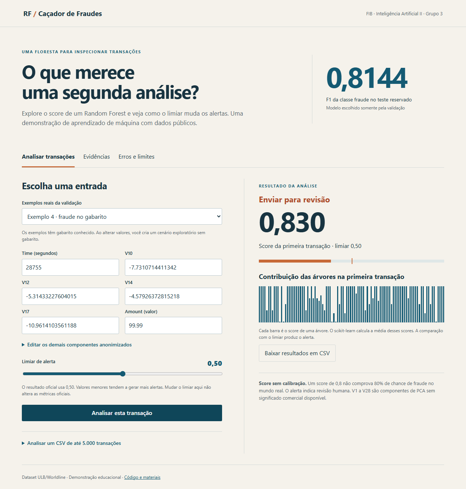
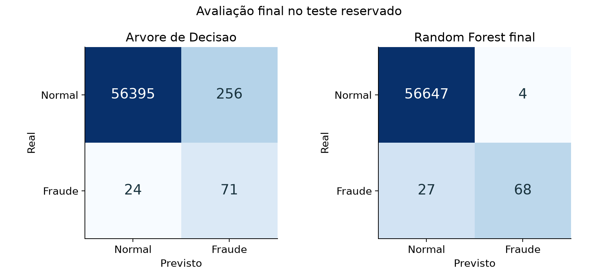

# Random Forest para triagem de fraudes

Projeto do Grupo 3 de Inteligência Artificial II, FIB. Apresentação em 17/11/2026.
Investigamos como selecionar transações para revisão humana, comparando uma
floresta com uma árvore isolada e contando fraudes encontradas e falsos alertas.

**[Comece pelo pacote de entrega e ensaio](entrega_final/00_COMECE_AQUI.md).**
Os PDFs antigos em `docs/` documentam o Checkpoint 1. A versão atual está em `entrega_final/`.



## Resultado principal

A configuração foi escolhida pelo F1 da fraude **na validação**, com limiar 0,50.
O plano e a decisão foram registrados antes de avaliar o teste. Foram mantidos o
treino de 60%, os dados e a semente 42 do checkpoint.

No **teste reservado**, a floresta final reduziu falsos alertas de 256 para 4,
mas encontrou 68 das 95 fraudes, contra 71 da árvore. Precisão, F1 e AP melhoraram
nesta comparação, com recall menor. Não há superioridade em todas as métricas
nem demonstração de desempenho em fraudes atuais.

| Modelo no teste | Precisão | Recall | F1 da fraude | AP | FP | FN | TP |
|---|---:|---:|---:|---:|---:|---:|---:|
| Sempre normal | 0,00% | 0,00% | 0,0000 | 0,0017 | 0 | 95 | 0 |
| Árvore de Decisão | 21,71% | 74,74% | 0,3365 | 0,5206 | 256 | 24 | 71 |
| Random Forest final | **94,44%** | 71,58% | **0,8144** | **0,7867** | **4** | 27 | 68 |

Teste: 56.746 transações e 95 fraudes. Positivo = fraude.
AP é Average Precision, calculada com `average_precision_score`; não é acurácia.
Intervalos de 95%: precisão **86,57–97,82%**, recall **61,81–79,67%** (Wilson),
F1 **0,7468–0,8721** (bootstrap estratificado, 1.000 repetições).
São intervalos condicionais ao modelo e à divisão; não cobrem mudança dos padrões
nem a variabilidade de novos treinos.



## Integrantes e apresentação

A divisão mantém as responsabilidades registradas pelo grupo. Os tempos são
metas para o ensaio, sem afirmar que ele já ocorreu.

| Integrante | Material | Slides | Tempo | Parte da fala |
|---|---|---:|---:|---|
| Lavinia Zanata Alves | Resumo e Instagram | 1–4 | 5 min | Problema, contexto e objetivo |
| Maicon Manoel Rodrigues dos Santos | Vídeo e Model Card | 5–8 | 7 min | Público, dataset e qualidade |
| Gabriel Damante Frias | Folder | 9–13 | 9 min | Random Forest e baseline |
| André Luiz Jeremias Pereira Junior | Ficha de experimentos | 14–19 | 10 min | Hipóteses, experimentos e métricas |
| Felipe Inácio de Paula | GitHub e protótipo | 20–23 | 9 min | Erros, demonstração e conclusão |

Núcleo de aproximadamente 40 minutos. Slides 24–25 são apêndices para referências
e perguntas. Cada integrante tem um [guia em PDF e Markdown](entrega_final/integrantes/).
Todos precisam saber explicar o projeto completo.

## Executar o protótipo

Python 3.12 e dependências em `requirements.txt`. No Windows:

```powershell
python -m venv .venv
.venv\Scripts\python.exe -m pip install -r requirements.txt
.venv\Scripts\python.exe -X utf8 src/app.py
```

Abra **http://127.0.0.1:8501**. Após a instalação, também é possível executar
`INICIAR_AQUI.bat` ou `INICIAR_PROTOTIPO.ps1`. No Linux/macOS, use `.venv/bin/python`.

**Não é necessário baixar a base nem retreinar para usar a aplicação.** Modelo e
exemplos estão incluídos. Após instalar dependências, a inferência funciona sem
internet. O servidor é local, em `127.0.0.1`, sem debug. Não há deploy público.

O protótipo oferece entrada manual, exemplos reais da validação, upload de CSV
de até 5.000 transações e 3 MB, score, sugestão de revisão, scores das 100 árvores
e download dos resultados. Também mostra experimentos, teste, erros e importância
por permutação. O limiar pode ser explorado, mantendo as métricas oficiais em 0,50.

`Class` é gabarito e é rejeitada como entrada. Colunas ausentes, extras, repetidas,
valores não finitos e Time/Amount negativos também são rejeitados. Os scores não
foram calibrados e não representam certeza nem autorização de bloqueio.

### Previsão por terminal

```powershell
.venv\Scripts\python.exe -X utf8 src/prever.py
.venv\Scripts\python.exe -X utf8 src/prever.py --csv demo/demo_final.csv --saida results/previsoes_demo_final.csv
```

O padrão usa `models/final/random_forest.joblib`. Somente carregue modelos de
origem confiável. O gabarito da demo fica separado em `demo/gabarito_final.csv`.

## Dados e preparação

Fonte: [Credit Card Fraud Detection, ULB/Worldline](https://www.kaggle.com/datasets/mlg-ulb/creditcardfraud).
São 284.807 transações de dois dias de setembro de 2013, com 492 fraudes.
Há 30 entradas: `Time`, `V1` a `V28` e `Amount`; `Class` é o alvo.
V1–V28 são componentes de PCA já fornecidos. Seus significados comerciais e a
transformação original não estão disponíveis.

- Sem ausentes na versão analisada.
- Remoção de 1.081 cópias completas adicionais: 283.726 registros e 473 fraudes restantes.
- Treino: 170.235 registros e 284 fraudes. Validação: 56.745 e 94. Teste: 56.746 e 95.
- Separação estratificada 60/20/20, semente 42; índices e hashes sem interseção.
- EDA detalhada no treino. Extremos preservados. Sem nova normalização ou PCA.
- Sem SMOTE ou balanceamento por reamostragem.

Descobertas: fraude é uma classe rara; a mediana de Amount no treino foi menor
nas fraudes (11,855) que nas transações normais (22,05); V17, V14 e V12 se destacaram
nas diferenças descritivas entre classes. Associação não estabelece causalidade.

Atribuição, licença e SHA-256 em [data/README.md](data/README.md). O CSV completo
não entra no Git. Para obtê-lo:

```powershell
.venv\Scripts\python.exe -X utf8 src/baixar_dados.py
```

## Experimentos controlados

Referência: 100 árvores, profundidade 12, duas amostras mínimas por folha,
pesos `balanced`, `max_features=sqrt`, bootstrap e semente 42.
Cada experimento altera **um fator em relação à referência**, com os mesmos conjuntos.

| Configuração na validação | Precisão | Recall | F1 | AP | FP | FN |
|---|---:|---:|---:|---:|---:|---:|
| Referência | 84,21% | 85,11% | 0,8466 | 0,8611 | 15 | 14 |
| E1 Sem pesos | 90,59% | 81,91% | **0,8603** | 0,8748 | 8 | 17 |
| E2 Profundidade 6 | 37,56% | 88,30% | 0,5270 | 0,8164 | 138 | 11 |
| E3 Sem V17/V14/V12 | 85,11% | 85,11% | 0,8511 | 0,8540 | 14 | 14 |

E1: a queda de falsos alertas veio com recall menor. E2: recall cresceu, com muitos
alertas falsos. E3: o efeito misto contrariou uma piora uniforme.
A [ficha](entrega_final/documentos/03_Ficha_experimentos.pdf) registra hipóteses,
alterações e interpretação.

Critério pré-fixado: maior F1 na validação, limiar 0,50, desempate por AP.
Foi escolhida `sem_pesos`. Não houve retreino com treino+validação. O teste foi
avaliado somente após salvar a decisão, sem ajuste posterior.

### Reproduzir e verificar

```powershell
.venv\Scripts\python.exe -X utf8 src/finalizar.py
.venv\Scripts\python.exe -m unittest discover -s tests -v
```

A execução final concluída é reutilizada. Para repetir integralmente as mesmas
decisões, após baixar o dataset, use diretórios separados:

```powershell
.venv\Scripts\python.exe -X utf8 src/finalizar.py --saida results/reproducao --modelos models/reproducao --nao-exportar-demo
```

Não mude parâmetros depois de conhecer o teste. O script `src/pipeline.py` e resultados antigos permitem reproduzir o
Checkpoint 1. A referência original foi reproduzida e suas métricas conferidas.

| Evidência | Arquivo |
|---|---|
| Hipóteses e plano prévio | [plano_pre_execucao.json](results/final/plano_pre_execucao.json) |
| Decisão antes do teste | [decisao_antes_do_teste.json](results/final/decisao_antes_do_teste.json) |
| Validação | [experimentos.csv](results/final/experimentos.csv) |
| Teste | [teste.json](results/final/teste.json) |
| Evidências reunidas e ambiente | [conclusao.json](results/final/conclusao.json) |
| Quatro erros reais da validação | [casos_erros.csv](results/final/casos_erros.csv) |
| Importância por permutação | [importancia_permutacao.csv](results/final/importancia_permutacao.csv) |

## Erros e Demo Challenge

- Linha 50537: fraude de Amount 1,00, score 0,000072, falso negativo.
- Linha 118308: fraude de Amount 30,14, score 0,000074, falso negativo.
- Linha 14920: normal de Amount 1,00, score 0,8228, falso positivo.
- Linha 164955: normal de Amount 119,99, score 0,8130, falso positivo.

Os casos são da validação; não atribuímos causas não verificadas. A importância
por permutação mede a queda de AP ao embaralhar uma variável na validação completa,
com três repetições. V14 apresentou a maior queda média, sem conclusão causal.

A plateia pode fornecer um CSV válido ou alterar uma entrada. Combinações
arbitrárias de componentes podem não representar transações reais e não têm
gabarito automático. O grupo deve explicar essas limitações e o efeito do limiar.

## Materiais de entrega

| Material | Arquivo |
|---|---|
| Organização e pendências humanas | [Comece aqui](entrega_final/00_COMECE_AQUI.md) |
| Slides PDF | [Apresentação](entrega_final/apresentacao/01_Apresentacao.pdf) |
| Slides HTML offline com roteiro | [Versão editável](entrega_final/apresentacao/02_Apresentacao_editavel.html) |
| Roteiro com perguntas e respostas | [PDF](entrega_final/apresentacao/03_Roteiro_completo.pdf) · [Markdown](entrega_final/apresentacao/03_Roteiro_completo.md) |
| Guias por integrante | [PDF e Markdown](entrega_final/integrantes/) |
| Resumo de duas páginas | [PDF](entrega_final/documentos/01_Resumo_expandido.pdf) |
| Model Card de uma página | [PDF](entrega_final/documentos/02_Model_Card.pdf) |
| Ficha de experimentos | [PDF](entrega_final/documentos/03_Ficha_experimentos.pdf) |
| Folder A4 com dobra | [PDF](entrega_final/divulgacao/01_Folder_dobravel.pdf) |
| Instagram | [Seis PNGs, PDF e legenda](entrega_final/divulgacao/) |
| Vídeo | [MP4 com narração sintética](entrega_final/divulgacao/05_Video_demonstracao.mp4) |
| Checklist | [PDF](entrega_final/documentos/04_Checklist_entrega_e_ensaio.pdf) |
| Diário de IA | [Markdown](entrega_final/documentos/05_Diario_de_IA.md) · [PDF](entrega_final/documentos/05_Diario_de_IA.pdf) |

Os slides são PDF e HTML, sem depender do PowerPoint. O HTML possui setas, tela
cheia e roteiro. Fontes editáveis: `entrega_final/fontes/` e `scripts/conteudo.py`.

**Antes de enviar:** confirmar orientador e e-mails em `scripts/identificacao.json`,
revisar o resumo, ensaiar e testar no computador da apresentação. Esses dados e
verificações não foram inventados. O pacote não faz a submissão no portal.

### Regenerar os documentos

```powershell
.venv\Scripts\python.exe -m pip install -r requirements-materiais.txt
.venv\Scripts\python.exe -X utf8 scripts/gerar_materiais.py
```

Os PDFs usam Arial do Windows. Em outro sistema, defina `ARIAL_FONT_DIR` com
`arial.ttf`, `arialbd.ttf` e `ariali.ttf`. A geração não executa novos experimentos.
A gravação opcional em `scripts/verificar_navegador.cjs` requer Playwright/Chromium.

## Limitações e fontes

Base de dois dias de 2013, poucos positivos, variáveis anonimizadas e divisão
aleatória. Sem independência conhecida por titular, validação temporal, calibração
ou custo financeiro medido. O escopo da PCA original é desconhecido. Uma semente
não mede a variação entre treinos. Uso educacional, sem autorização de bloqueios reais.

[Oito referências e suas contribuições](docs/referencias.md), incluindo cinco artigos.
O resumo segue a estrutura e a fonte Arial 10 indicadas nas
[normas da Jornada Científica FIB 2026](https://fibbauru.br/site/conteudo/176-modelos-para-apresentacao-dos-trabalhos.html).
O logo foi obtido do modelo oficial de resumo.

O [football-pca-map](https://github.com/ViniciusSilveiraCampos/football-pca-map) foi
consultado, a pedido do grupo, como referência de organização de experimentos,
evidências e demonstração. Seus dados, métricas, textos e código não foram incorporados.
Os resultados deste projeto pertencem à análise da base ULB/Worldline.
